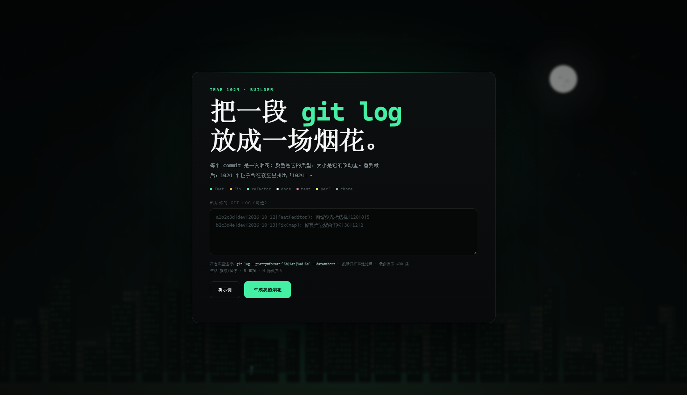
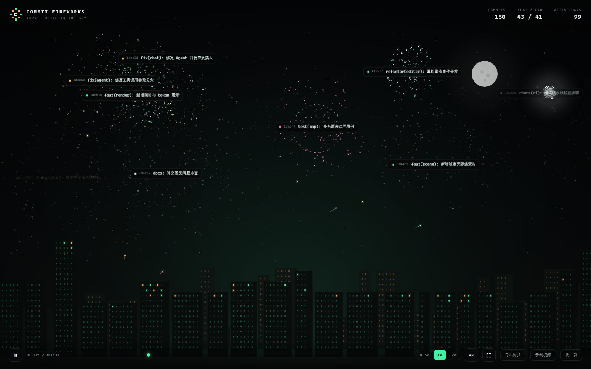
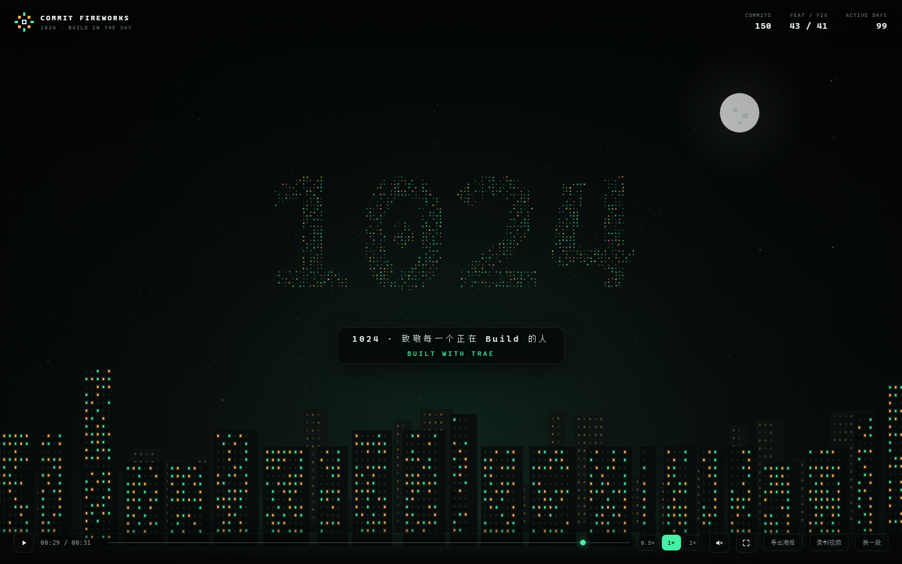

# Commit Fireworks · 1024

> 把一段 `git log` 放成一场烟花。每个 commit 是一发烟花：颜色是它的类型，大小是它的改动量；城市按提交日期一扇窗一扇窗地亮起来，最后 1024 个粒子从整座城市的窗户升空，在夜空里拼出「1024」。

[在线体验](https://heigoo.github.io/commit-fireworks/) · [MIT License](LICENSE) · 单文件 HTML，无构建、无依赖、可离线运行



## 玩法

打开页面后有三种进入方式：

1. **粘贴自己的 git log** —— 在任意仓库执行下面的命令，把输出贴进输入框，点「生成我的烟花」。
2. **抓取 GitHub 热门项目** —— 点一下按钮，页面会按 star 选出近期活跃的热门仓库，混合其中最近的提交并立即播放。
3. **看示例** —— 直接播放内置示例数据，先看效果。

## 数据格式

```bash
git log --pretty=format:'%h|%an|%ad|%s' --date=short --numstat
```

每行左侧是 `hash|author|date|subject`，紧随其后的 `--numstat` 明细行会累加成「增/删/文件数」，用来决定烟花的大小。`--numstat` 可以省略，此时大小按提交哈希做稳定估算。

也可以在链接里直接带数据：`index.html#log=<encodeURIComponent(git log 文本)>`，打开即自动播放（上限约 8KB）。

## 特性

- **颜色即类型**：`feat` / `fix` / `refactor` / `docs` / `test` / `perf` / `chore` 各有一套配色，同时识别 Conventional Commits 前缀和常见中英文关键词。
- **大小即改动量**：内联的增删行数决定烟花当量，里程碑式的大提交会明显更大。
- **城市会生长**：播放过程中每绽放一发烟花，就点亮城市里的一扇窗；提交越多、时间跨度越长，城市越完整。
- **终场 1024**：播放到最后，已经点亮的窗户统一补光，1024 个粒子从窗户位置升空拼出「1024」。
- **可交付**：支持一键导出 1024 海报（PNG）与录制整段视频（WebM）。
- **可回看**：进度条拖拽、0.5×/1×/2× 变速、空格播放暂停、`R` 重播、`←`/`→` 步进（`Shift` 加大步长）、`H` 隐藏界面。
- **体贴细节**：尊重系统「减弱动态效果」偏好，界面文案对屏幕阅读器友好，窄屏可用。

| 播放 | 终场 |
| --- | --- |
|  |  |

## GitHub 抓取是怎么工作的

- 只在你点击按钮时才发请求，默认打开页面不会访问任何第三方域名。
- 使用 GitHub 公开 REST API：先 `search/repositories`（`stars:>50000` + 近 30 天有推送 + 非归档，按 star 排序取前 40），再从中随机抽 8 个仓库，每个仓库取最近 25 条提交。
- 单次抓取共 9 次请求。匿名额度为 **核心接口 60 次/小时、搜索接口 10 次/分钟**，额度用尽时页面会给出提示。
- 提交列表接口不返回增删行数，因此抓取模式下烟花大小按提交哈希估算；想要真实的改动量，请用本地 `git log --numstat` 粘贴。
- 抓取模式只读取公开仓库的公开提交信息；粘贴模式的数据完全在浏览器内处理，不会上传。

## 本地运行

```bash
python -m http.server 8899
# 打开 http://localhost:8899/index.html
```

也可以直接双击 `index.html`（`file://` 协议下同样可用）。

## 技术说明

- 全部代码在单个 `index.html` 里：Canvas 2D 绘制，无框架、无外部请求依赖、无构建步骤。
- 渲染分两层：`#bg` 承载渐变天空、星野与城市静态层，`#fx` 承载烟花、粒子与浮层标签；窗户点亮使用 `Path2D` 缓存，终场定形后走离屏缓存。
- 数据解析只有一个入口 `parseLog()`，兼容 `%h|%an|%ad|%s` + `--numstat` 与纯短 hash 两种文本形态。

## License

[MIT](LICENSE) © 2026 heigoo
